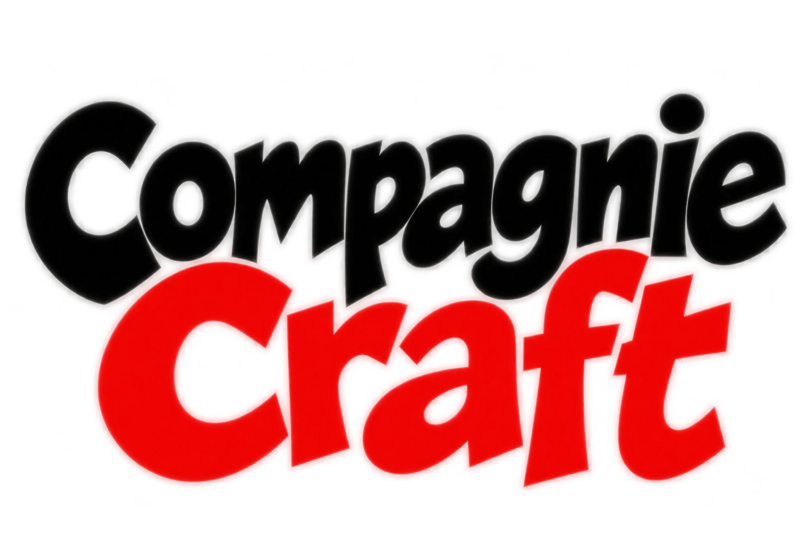

<p></p>

# CompagnieCraft

[](https://github.com/ToF447/CompagnieCraft/actions/workflows/checks.yml)

CompagnieCraft est un logiciel libre en développement pour les petites troupes et associations du spectacle vivant. Il réunit des outils de prospection, de suivi des candidatures et d’organisation du travail artistique.

Le code est gratuit à consulter, installer et adapter sous licence **AGPL-3.0-only**. Le projet s’appuie sur le partage de connaissances et l’échange entre les personnes.

## Ce que contient cette version

- Des fiches de spectacles, de contacts et de lieux.
- Une recherche de pistes dans des sources publiques, avec des critères géographiques et artistiques.
- Un suivi des candidatures, des échanges et des relances.
- Un planning, un agenda et des outils de préparation des productions.
- Une bibliothèque de références, des exercices d’atelier et un générateur d’improvisations.

**Chaque module demande un temps de configuration initiale.** Renseignez les informations utiles à son usage : spectacles, disciplines, publics, localisation, rayon de déplacement et conditions d’accueil. Plus ces renseignements sont précis et à jour, plus les informations et les pistes proposées peuvent être pertinentes et adaptées à votre troupe. Ces réglages se complètent et se modifient au fil de l’utilisation.

**Cette version est une version de développement.** La démonstration locale utilise des données fictives. Les pistes de recherche ne garantissent ni une candidature ouverte, ni une date disponible. Les fonctions de partage et les comptes réels nécessitent un serveur configuré ; ils ne sont pas activés par le simple lancement de la démo.

## Essayer la démo en ligne

La [démo en ligne](https://compagniecraft.org) s’ouvre dans un navigateur sur Windows, macOS, Linux, Android ou iOS, sans installation. Son accès dépend de la protection de l’hébergement actuel.

Le bouton **Essayer la démo complète** ouvre un parcours avec une troupe fictive : spectacles, candidatures, projet de tournée, budget, planning et feuille de route. Les textes, disponibilités et retours communautaires y disposent d’un bac à sable local clairement signalé. Aucune invitation, publication ou transaction réelle n’est déclenchée par ce scénario.

## Installer la démonstration sur son ordinateur

**Première installation ? Suivez la [notice pas à pas](INSTALLATION.md)** : téléchargement, Windows/macOS/Linux, démarrage, données et dépannage. Elle précise les fonctions disponibles et celles qui ne sont pas raccordées dans la démo.

Prérequis : Node.js 22.13 ou plus récent et npm. Les recherches en direct demandent une connexion Internet.

```sh
npm ci
node build-source-worker.cjs
node preview-source-worker.mjs
```

Ouvrir [http://127.0.0.1:4334/](http://127.0.0.1:4334/), puis utiliser **admin / admin**. Cet accès ouvre uniquement la démonstration : ne pas y saisir de données confidentielles.

## Documentation technique

- [Guide de reprise](docs/maintainer-guide.md)
- [Architecture et limites actuelles](ARCHITECTURE.md)
- [Recherche : sources, dates et limites](docs/venue-search.md)
- [Backend PHP : installation et périmètre](backend/DEPLOY.md)
- [Contribuer au code](CONTRIBUTING.md)

Les sources de l’interface sont dans `dist/`, les services serveur dans `worker/` et `backend/`. Ces deux implémentations serveur ne couvrent pas encore les mêmes fonctions.

Les contrôles locaux se lancent avec `npm run check`. Les contrôles PHP supplémentaires demandent PHP 8.2+ avec PDO SQLite : `npm run check -- --php`.

## Licence et crédits

**Développement initial : ToF.**

Voir [LICENSE](LICENSE) et [NOTICE.md](NOTICE.md). Les photographies, polices et données tierces conservent leurs licences et leurs crédits.
